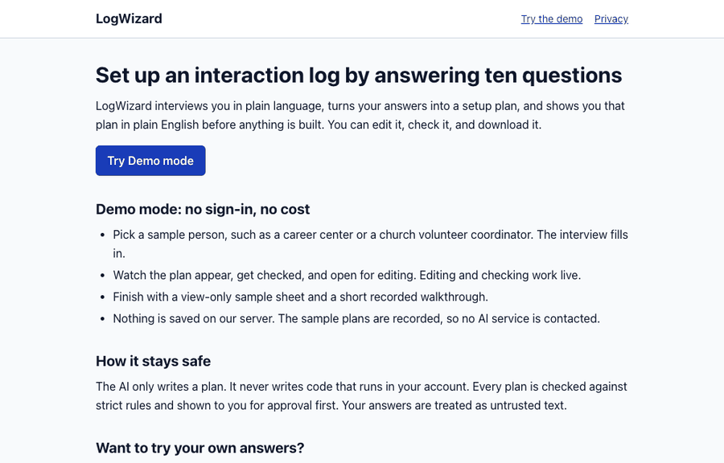
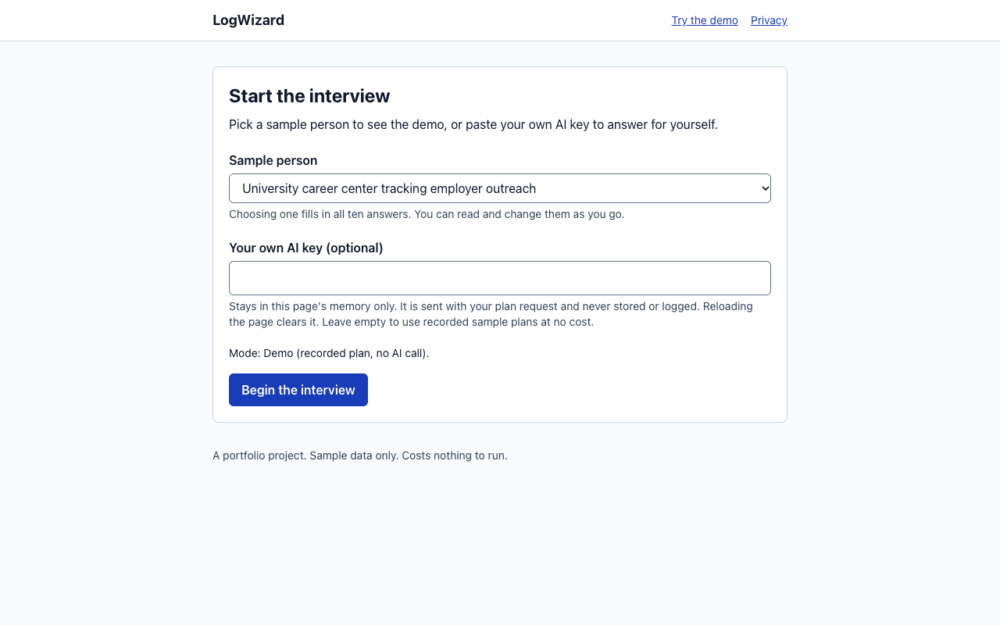
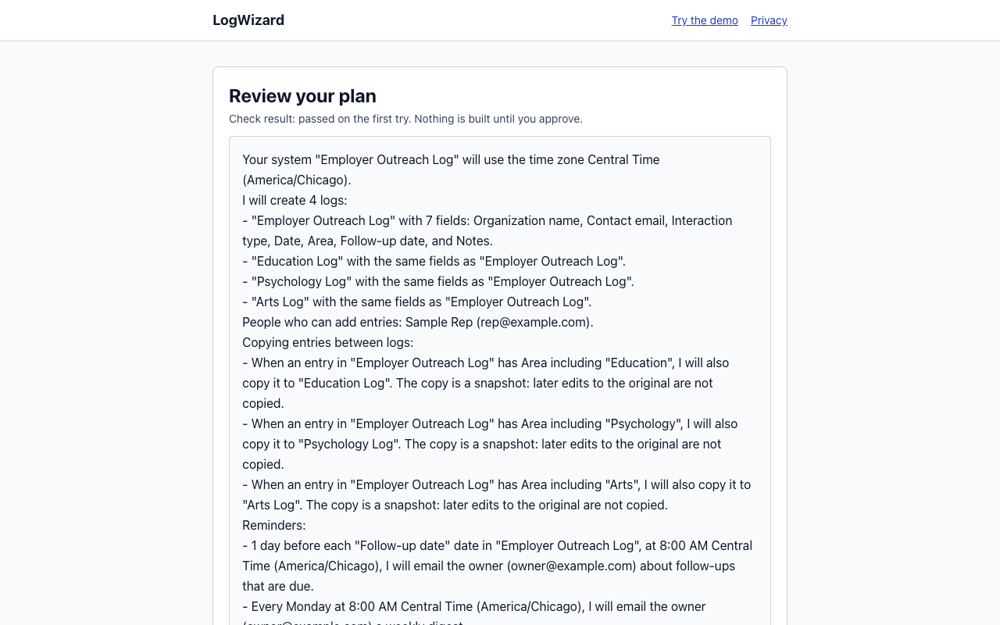

# LogWizard

**Working name.** The final name is not decided (`docs/OPEN_ITEMS.md`).

**Live demo (no sign-in, no key): https://logwizard.vercel.app**  
Source: https://github.com/MarginNMethod/logwizard

LogWizard is a web app that sets up an interaction-logging system in a person's own Google account. An interaction log is a spreadsheet where each row records one contact, such as an email with an employer. The system adds an entry form, copies entries between related logs, sends follow-up reminders and a weekly digest, and alerts the owner when someone else adds an entry.

It is modeled on a system built by hand five times for a university career center. It is a portfolio project, not a product. It costs nothing to build or run (`docs/decisions/0005-zero-cost.md`).

Start with `docs/case-study.md` for the story, or `docs/FINAL_REVIEW.md` for what is proven and what is not.

---

## The idea: the AI writes a plan, not code

The app interviews the user in plain language. An AI step turns the answers into a JSON plan. A fixed schema and validator check the plan against strict limits, and the user reviews a plain-English preview and can edit it. Only then does a tested engine build the system.

The AI never writes code that runs in a user's account. A bad plan can be caught by validation and by the person reading the preview. A bad script would run with the user's own permissions, so the design avoids that case (`docs/decisions/0002-plan-not-code.md`).

---

## What is proven, and what is not

Read this section before quoting any claim from this repository. Dates are 2026-10-12.

**Built and tested offline**

- Plan schema and validator, with hardening found by independent review (`packages/plan-schema`, 201 tests).
- Routing, reminder, digest, send-cap and alert logic as pure functions (`packages/engine-logic`, 85 tests).
- Apps Script engine, bundled into one 228.7 KB file with 6 OAuth scopes (`apps-script`, 67 tests).
- Web app: interview, plan preview with editing, plan download, Demo mode (`apps/web`, 66 tests).
- Eval set: 17 synthetic personas (5 held out), recorded plans, a grading runner (`evals`, 37 tests).
- **456 tests in total** (`CI=1 pnpm -r test`). They use fake Google services and recorded plans. They do not call Google or an AI.

**Proven by hand in a real Google account (personal Gmail, 2026-10-12)**

- Activate builds the tabs, the Google Form and 2 triggers, and a second Activate changes nothing.
- A contributor can submit through the Form with no permission prompt. The owner gets an alert email.
- The sidebar saves an entry to the log and its routed copy.
- The weekly digest and a follow-up reminder each arrived once, and a second run sent no duplicates.
- Google's first-run permission list showed exactly five permissions, none broad.
- A real bug that the offline tests missed: a form answer of `=SUM(A1)` was evaluated as a formula. It is fixed and re-tested in real Google (`SPIKES.md`).

**Live and checked**

- The demo site and the anonymous metrics database (Vercel Hobby, Supabase Free) are live, and one test event was stored and then deleted. No emails, answers or plans are stored (`docs/privacy.md`).

**Not done, not tested**

- **The step that connects the web app to Google is not built.** There is no Google sign-in in the web app, and it does not copy the template or install the engine for a visitor. Today the engine is installed by hand with `clasp` and tested directly. This is the main gap between the demo and the full product (`PLAN.md`, Phase 4).
- A Google Workspace account, a second Google account using the sidebar, and the daily send-limit warning paths have not been tested in real Google.
- The planner has only run on plans recorded by Claude Code subagents. No live model call was made, by design.
- The eval is small and not independent: 17 personas, one run each. 12 were used to tune the prompt, and 5 held-out personas were written and committed before the final run. All were written by the same author as the prompt (`evals/results-notes.v2.md`).
- Accessibility (WCAG 2.1 AA) has not been audited.
- A narrated video and a Google-side walkthrough (Activate, Form, reminder email) do not exist yet. The sample sheet link does not exist yet (`docs/demo-script.md`).
- Microsoft: design only (`docs/MICROSOFT_ADAPTER.md`).
- The measured before and after setup times for the case study (see the case study).

---

## Try it

Demo mode needs no Google sign-in and no API key. Use the live site above, or run it locally:

```bash
pnpm install
pnpm -r test                          # unit tests, no keys needed
pnpm --filter @logwizard/web dev      # then open http://localhost:3000/start
```

Pick a sample person in **Sample person**, then click **Begin the interview**. The plan comes from recorded plans in `evals/recordings/`.

Other commands:

```bash
pnpm --filter @logwizard/web build        # production build of the web app
pnpm --filter @logwizard/apps-script build # bundles the Apps Script engine (offline)
```

Requirements: Node.js and pnpm (the root `package.json` pins `pnpm@10.0.0`). The eval runner needs Node 22.15 or newer (`evals/README.md`).

A 30-second silent capture of Demo mode, from the interview to the approved plan (Playwright, 2026-10-12). It shows the web app only, not Google:



Still images:

| Start | Plan review |
|---|---|
|  |  |

---

## Repository map

| Path | What it is |
|---|---|
| `apps/web` | Next.js web app: interview, preview, Demo mode, API routes |
| `packages/plan-schema` | Zod schema, limits, validator, plain-English summary, fixtures, tests |
| `packages/engine-logic` | Pure routing, reminder, digest, send-cap, and alert logic, with tests |
| `apps-script` | The Google Apps Script engine (TypeScript source, esbuild bundle, build check, manual Google test script) |
| `evals` | Personas, planner prompts (v1, v2), recordings, eval runner, results |
| `supabase` | Anonymous metrics migrations and the server contract |
| `docs` | Requirements, user stories, data model, test plan, traceability, privacy, setup guide, demo script, case study, final review, Microsoft design |
| `docs/decisions` | Decision records (ADRs) |
| `docs/gates` | Gate reports from the build |
| `PLAN.md` | The build plan |
| `SPIKES.md` | Google behaviour checks, including the hands-on results |
| `AUDIT.md` | Review of the first draft of the plan |

## Documentation

- Case study (the story for a reader who is not an engineer): `docs/case-study.md`
- What is proven and what is not, plus the review of these documents: `docs/FINAL_REVIEW.md`
- Problem, users, goals, and requirements: `docs/requirements.md`
- User stories: `docs/user-stories.md`
- Data model (plan schema and sheet structure): `docs/data-model.md`
- Test plan, eval set, and UAT script: `docs/test-plan.md`
- Requirement traceability: `docs/traceability.md`
- Demo walkthrough (3 minutes): `docs/demo-script.md`
- Microsoft adapter design: `docs/MICROSOFT_ADAPTER.md`
- Privacy: `docs/privacy.md`
- Setup steps only the owner can do: `docs/setup-guide.md`
- Open decisions: `docs/OPEN_ITEMS.md`
- Decisions: `docs/decisions/`

## Privacy and zero cost, in short

- No emails, interview answers, plans, or sheet links are stored on the project's server. The only server data is anonymous funnel counts and rate-limit counters (`docs/privacy.md`).
- No paid plan, paid API, purchased domain, or server-side AI key is part of the design (`docs/decisions/0005-zero-cost.md`).
- Sample data uses `example.com` addresses only.
