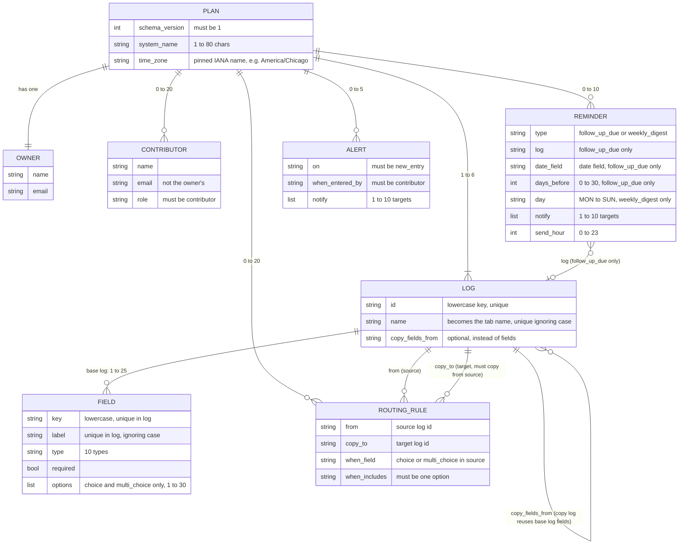
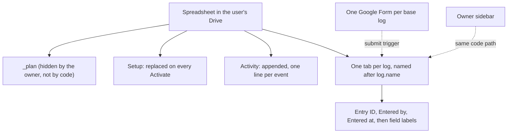
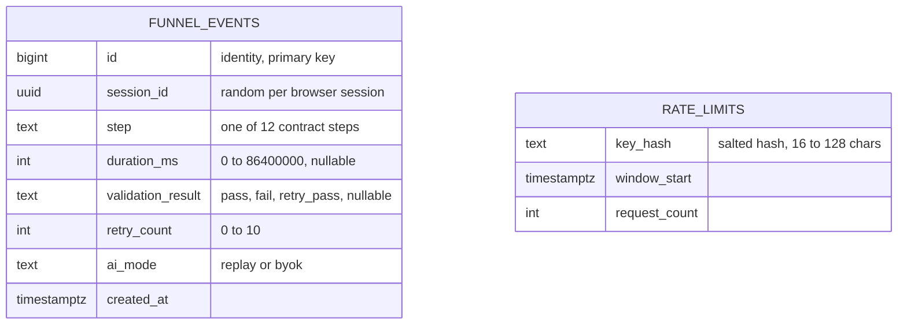

# Data model

Status: describes the code as it stood on 2026-10-11. Sources are cited inline: `packages/plan-schema/src/` (the plan), `packages/engine-logic/src/` (entries, routing, reminders), `apps-script/src/core.ts` and `apps-script/src/google.ts` (the sheet, form, triggers, and properties), and `supabase/migrations/` (metrics).

The engine was run by hand in a real personal Gmail account on 2026-10-12 (`SPIKES.md`, "Hands-on results"). The step that copies a template and installs the engine for a visitor (Phase 4) is not built. Workspace accounts are untested. Most of what is described below is covered by fake-service tests, and the hand run confirmed Activate, the Form, the sidebar, the digest and a follow-up reminder.

---

## 1. Four places data lives

| Store | What it holds | Personal data? | Source |
|---|---|---|---|
| The plan | One JSON document. The AI proposes it, the validator checks it, the user can edit it. | Owner and contributor names and emails, field labels. | `packages/plan-schema` |
| The user's sheet | One tab per log (entries), plus `_plan`, `Setup`, and `Activity`. | Yes, entries and emails. Lives only in the user's Google account. | `apps-script/src` |
| Script properties | Form ids, daily send counts, sent-reminder keys. Hidden from the sheet. | Email addresses inside sent keys. Lives in the user's script project. | `apps-script/src/core.ts` |
| Supabase (optional) | Anonymous funnel events and rate-limit counters. No link to any plan or row. | No. | `supabase/migrations/` |

The project never stores a plan, an answer, or an entry on its own server (`docs/privacy.md`).

---

## 2. The plan (schema_version 1)

The plan is the contract between the AI step and the engine. The validator (`validatePlan`) is the same code in the web app and in the bundled Apps Script engine.

### 2.1 Entity relationships

Notes on the diagram:

- A **base log** has its own `fields`. A **copy log** has `copy_fields_from` instead. A log has exactly one of the two (ADR 0006, rule 2).
- A routing target is always a copy log of the rule's `from` log, so copied rows fit its columns (`schema.ts`, `crossChecks`).
- Notify targets are `owner`, `contributors`, or an email that is the owner or a listed contributor.

### 2.2 Limits

Read from `packages/plan-schema/src/limits.ts`.

| Limit | Value |
|---|---|
| Logs per plan | 6 |
| Fields per log | 25 |
| Routing rules | 20 |
| Reminders | 10 |
| Alerts | 5 |
| Contributors | 20 |
| Notify targets per reminder or alert | 10 |
| Options per choice field | 1 to 30 (each at most 60 characters) |
| Names and labels | 80 characters |
| Log ids and field keys | 40 characters |
| Emails | 254 characters |
| `days_before` | 0 to 30 |
| Plan JSON size | 64 KB (`MAX_PLAN_BYTES` in `validate.ts`) |

### 2.3 Field types

| Type | Sheet cell rule (`google.ts`, `core.ts`) | Form item (`FORM_KIND`) |
|---|---|---|
| `text` | Plain text | Short answer |
| `long_text` | Plain text | Paragraph |
| `email` | Email validation on the cell | Short answer with email check |
| `phone` | Plain text, no check | Short answer, no check |
| `date` | Date pattern check (`YYYY-MM-DD`) | Date item |
| `number` | Number check | Short answer with a number check |
| `choice` | Dropdown from options | Dropdown list |
| `multi_choice` | Plain text, comma-joined values | Checkboxes |
| `yes_no` | Dropdown: Yes, No | Multiple choice: Yes, No |
| `url` | URL validation on the cell | Short answer with a URL check |

### 2.4 Text rules that apply everywhere

Read from `packages/plan-schema/src/text.ts` and ADR 0006 and 0007.

- After trimming and NFKC folding, a plan string is rejected if it starts with `=` or `@`, if it starts with `+` or `-` followed by a digit or `(`, or if it contains a control, format, or private-use character.
- A leading `+` or `-` is allowed only when followed by a space or the end of the string. So `- Other -` and `+ Add new` pass, and `+SUM(A1)` and `-5` do not.
- Keys and ids are lowercase letters, digits, and underscores. Some words are reserved (for example `entry_id`, `entered_by`, `__proto__`).
- Options cannot contain a comma, because multi-choice answers are joined with commas.

### 2.5 Reserved names

Log names that the validator rejects (ignoring case): `_plan`, `Setup`, `Activity`, `Entries`, `Form Responses 1`, and any name starting with `_`. These protect the tabs the engine creates and the tab Google makes for form responses (the engine does not link its forms to the sheet, so that tab is not created by the engine).

---

## 3. The sheet the engine builds

### 3.1 Tabs

| Tab | Created by | Headers | Behaviour |
|---|---|---|---|
| `_plan` | The template (the owner pastes the plan JSON into column A) | None | `readPlanText` joins all non-empty cells of column A in order, so a long plan can span rows (`google.ts`). The code does not hide the tab. The setup guide asks the owner to hide it. |
| `Setup` | `Activate` | `Setting`, `Value` | Cleared and rewritten on each Activate (`replaceSetup` calls `clear()`). Rows: System, Activated at, Owner, Time zone, Triggers installed, Daily email limit, one Form link per base log, and a Note. |
| `Activity` | `Activate` or the first log line | `When`, `Level`, `Message` | Append-only. Levels are `info`, `warning`, `error`. Messages are plain language. |
| One tab per log | `Activate` | See 3.2 | Existing tabs are never overwritten. If the headings differ, the tab is left alone and a warning is written to `Activity`. |

### 3.2 Log tab columns

Header row = `META_HEADERS` followed by the field labels, in plan order (`entry.ts`, `headersForLog`).

| Column | Header | Value |
|---|---|---|
| A | `Entry ID` | `e_` followed by 32 lowercase hex characters (`makeEntryId`) |
| B | `Entered by` | Submitter email, else the name answer, else `unknown` |
| C | `Entered at` | ISO instant in UTC, for example `2026-03-01T14:00:00Z` form |
| D onward | Field labels | One column per field, in plan order |

A copy log has the same columns as the base log it copies (`logFields`). Each log tab has a frozen header row and its data cells are formatted as plain text (`@`).

**Formula safety.** `sanitizeCellValue` puts a leading apostrophe in front of any value that starts with `=`, `+`, `-`, or `@` (after spaces), or with a tab or carriage return. The engine also sets the cell format to plain text. Whether Google shows the apostrophe is an open H2 check (`apps-script/README.md`, item 6).

### 3.3 Entries, IDs, and routing snapshots

- **Entry ID.** `makeEntryId({ seed, logId, submittedAt })` is deterministic. The seed is the form response id for a form submission, or a random UUID for a sidebar entry. The same submission always gives the same id, so a repeated form event writes nothing twice (`core.test.ts`, "a repeated form event (same response id) writes nothing twice").
- **Copies share the Entry ID.** A row copied by routing keeps the original's Entry ID, so the same entry can be found in each tab.
- **Routing is a snapshot.** A copy holds the values as they were when it was routed. Editing the original row later does not change the copy (PLAN.md section 4, known limit). Running "Run routing now" again adds only missing copies. It skips any target that already holds the Entry ID (`planRouting`).
- **Read back.** Rows are read as text, a leading apostrophe is removed only where it guards `= + - @`, and multi-choice values are split on commas (`rowToEntry`, `parseValue`).

### 3.4 Script properties (hidden from the sheet)

| Key | Value | Written by | Purpose |
|---|---|---|---|
| `formId:<logId>` | Form id | `activate` | Matches a form submission to its base log |
| `activatedAt` | ISO instant | `activate` | Recorded in `Setup` |
| `sendCount` | `{"date":"YYYY-MM-DD","count":n}` | `deliver` | Emails sent today, in the plan's time zone |
| `sent:<YYYY-MM-DD>` | JSON array of send keys | `deliver` | Stops a reminder being sent twice. Keys older than 2 days are pruned. |
| `capNotice` | `<date>\|<warn or limit>` | `deliver` | One Activity warning per day at 80 percent, and one when emails are deferred |

Daily caps (`DAILY_CAPS`, `dailyCapFor`): 100 for `gmail.com` and `googlemail.com` owners, 1500 for other addresses. The caps come from `SPIKES.md` Spike 5 and are documented limits. In real Google, the alert, test reminder, follow-up and digest emails all sent normally. The 80% and 100% cap paths are not tested in real Google.

### 3.5 Triggers

| Name | Handler | Kind | Created by |
|---|---|---|---|
| `hourly` | `hourlyTick` | Time-driven, hourly | `activate` |
| `form_submit` | `onFormSubmit` | Form submit, one per base-log form | `activate` |

`activate` deletes only triggers whose handler is in this list, then creates them again. Running Activate twice gives the same two-trigger inventory per form (`core.test.ts`, "is idempotent" and "removes only its own old triggers").

### 3.6 OAuth scopes

Six scopes, pinned in `apps-script/appsscript.json` and checked by `apps-script/check.mjs` at build time: `spreadsheets.currentonly`, `forms`, `script.scriptapp`, `script.send_mail`, `script.container.ui`, `userinfo.email` (added after the second H2 run: without it Google returned a blank sidebar user, so the owner's entries were recorded as `unknown`). None is a restricted scope (`apps-script/README.md`).

---

## 4. Metrics tables (Supabase, optional)

Not linked to the plan or the sheet. No column can hold an email, an answer, a plan, or a sheet link (`supabase/CONTRACT.md`, `supabase/verify.sql`).

`RATE_LIMITS` has the primary key `(key_hash, window_start)`. Both tables have row level security on and no policies, and all privileges are revoked from `anon` and `authenticated`. Rows older than 90 days are removed by `metrics_retention_90d` if `pg_cron` is available (`supabase/migrations/20261011000100_metrics_retention_cron.sql`). The migrations are written. This pass did not check whether they have been applied to a project.

---

## 5. Known limits and open checks

| Item | Status | Source |
|---|---|---|
| Copies are snapshots, not live links | By design, documented | PLAN.md section 4 |
| `Setup` is rewritten on each Activate | By design | `google.ts`, `replaceSetup` |
| Submitter identity (`Entered by`) on personal and Workspace accounts | Personal account done: the Form email checkbox and the sidebar (with `userinfo.email`) both recorded the email. Workspace pending. | `SPIKES.md` |
| Whether Google shows the leading apostrophe in a formula-safe cell | Confirmed: the cell shows no apostrophe and stays text (H2 check 22) | `SPIKES.md` |
| Form trigger runs as the owner, contributors see no prompt | Confirmed on a personal account: contributors see no prompt (`SPIKES.md`) | ADR 0003 |
| Most behaviour above was tested with fake services. The real-Google run covered Activate, Form submit, sidebar, digest and follow-up | Partly true today | `apps-script/test/fakeServices.ts` |
| Unassigned Unicode characters are not rejected | Accepted for now | ADR 0007 |
</content>
